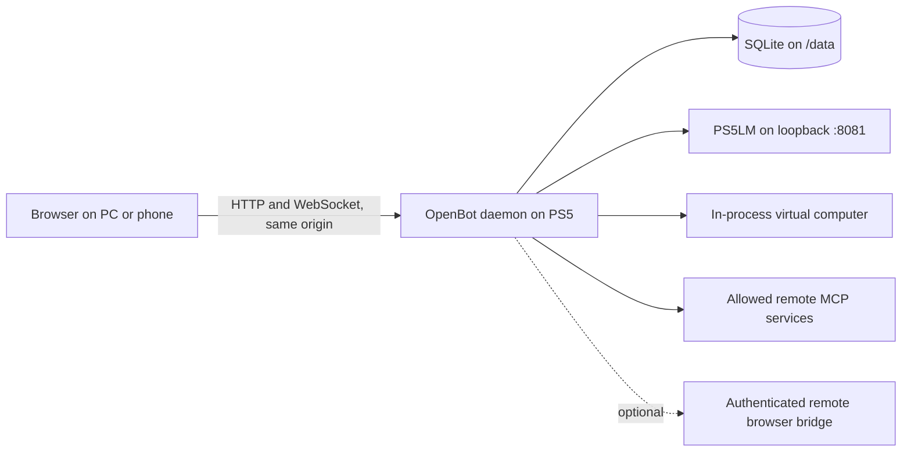

# OpenBot on PS5 and the web: port plan

Status: architecture and delivery plan, not an implemented or verified port. Baseline: upstream commit `3083c34b0e9153b86c532112bdf0048202e91000`. Maintain a compatibility matrix against this baseline and update it when upstream changes.

## Goal and access

The PS5 runs one native daemon, serving the OpenBot browser interface and its API while using PS5LM locally. Visitors need a browser; the browser renders the UI and the PS5 performs the server-side work. On the PS5 use `http://127.0.0.1:<port>/`; from another device use `http://<current-PS5-IPv4>:<port>/` or its configured hostname. Bind the PS5 service to the configured interface (or all interfaces for LAN use), discover or display the current IPv4 at runtime when feasible, and never embed a fixed console address. `localhost` on a visitor's phone or PC refers to that device, not the PS5. The host build of the same server supports development and standalone web hosting. For access over the internet, a separately configured HTTPS reverse proxy must forward HTTP and WebSocket upgrades; internet reachability, certificates and authentication are deployment tasks, not implied by binding a LAN port. Some browser capabilities such as microphone access require a secure context.

The remote browser bridge is optional and runs elsewhere. The default PS5 computer is a restricted virtual workspace and HTML reader, not a Chromium equivalent: JavaScript-heavy sites and full browser automation need the bridge. Represent missing capabilities honestly in the UI and compatibility matrix. Voice, recorder and external integrations also require explicit implementations or documented limitations; do not claim full OpenBot parity until all requested workflows are accounted for.

## Evidence and constraints

The checkout has a MIT-licensed application template and API specifications; it does not include the server source. The existing backend is distributed as an image and Intelligence is separately licensed. The replacement must implement the observed public contract; frontend and specification coverage cannot establish private backend internals. `api/openapi/common.yaml` indexes 334 API paths. `api/asyncapi.yaml` defines several distinct realtime protocols. `app/src/lib/client.ts`, `app/src/lib/auth/client.ts` and `app/src/lib/socket-url.ts` establish same-origin browser behavior. The app build needs the root Bun workspace, `shared`, configuration generation and pinned dependencies. Audit specific versions and licenses of dependencies before distribution.

PS5 restrictions from the brief are requirements to validate on the actual console: no process spawning, tiny bounded memory, FreeBSD 11 ABI, `/data` mount race, and SQLite TRUNCATE rather than WAL. The installed nightly does not list `x86_64-sie-ps5-std` as a built-in target; a verified target specification, runtime and SDK linker integration are prerequisites. Cross-linking alone is not proof of runtime compatibility. PS5LM is currently offline; work against a deterministic local substitute until hardware is available.

## Architecture

1. **One origin.** Serve versioned Vite assets and API/WebSocket upgrades from the Rust service. Correct MIME types and immutable cache headers for hashed assets; serve index only for navigation routes. Missing assets, `/api` paths and failed upgrades must never silently return index HTML. Use relative requests in production. A separate API origin is deferred because auth, cookies, CORS, direct fetches and sockets all need coordinated changes.
2. **Backend modules.** Separate HTTP/auth, organizations, bots, conversations, model routing, realtime, governance, computer, MCP, schedules, and persistence behind interfaces in a self-contained repository. Axum/Tokio/Reqwest/Rustls and bundled SQLite are candidates, subject to PS5 runtime validation. Host and PS5 use the same business logic with platform-specific storage, networking and lifecycle adapters. Bound concurrent requests, message sizes, replay, tool output, run queues and caches. Expose readiness, local diagnostics and structured redacted logs.
3. **Storage.** Versioned SQLite migrations; enable foreign keys on every connection, short transactions, bounded busy handling and a controlled writer. Explicitly set and verify `journal_mode=TRUNCATE`. Use org-scoped keys and authorization, consistent backups and tested restore. Store ordered conversation events and durable run state; define caps and retention gaps without silently dropping active runs. Append audit entries for decisions and outcomes, with redaction; application restrictions and triggers are not protection against someone who controls the database file. Verify bundled SQLite's FreeBSD 11 stat shim, locking, sync, truncation and restart recovery on hardware. Retry `/data` readiness with bounded backoff; surface failures instead of silently writing data elsewhere.
4. **Identity and credentials.** Implement the actual Better Auth/client contract and organization-scoped permissions for each REST request and socket. Use expiring sessions, HttpOnly SameSite cookies, origin/CSRF checks, Secure cookies on HTTPS, and a limited first-admin bootstrap. Encrypt credentials using authenticated encryption and unique nonces, with a per-install key outside the database, restricted permissions, rotation and recovery. PS5 key protection remains unverified; a key stored on the same device cannot withstand full device compromise. Do not send secrets to browsers or logs.
5. **Conversation engine.** Authenticate, persist the request, stream model output, turn fragmented model tool calls into complete validated calls, route each through policy and approval, record the result, and continue the model turn. Emit ordered AG-UI events and persist replay IDs. Bound concurrency and memory, propagate cancellation and never blindly retry an action whose external outcome is unknown after a crash.
6. **Model adapters.** Host mode uses a configurable PS5LM URL; PS5 mode defaults to loopback. Discover `/v1/models` and `/props` with timeouts and stale/unavailable state. Read preset sidecars only from a configured trusted path and validate them; define explicit override precedence. Expose only verified model/effort capabilities; do not assume selecting an inactive model switches PS5LM. Map the upstream catalogue and selection contract, with a gateway representation if appropriate. Implement OpenAI-compatible, Anthropic and Gemini protocols separately as supported, with credentials kept server-side. Confirm reasoning, tool streaming, slot/prefix caching and switching against live PS5LM before claiming support.
7. **Realtime.** Implement the actual Phoenix Channels v2 contract: REST-provided topic and short-lived, single-use join token; `/api/intelligence/client/websocket?join_token=...&vsn=2.0.0`; `[join_ref, ref, topic, event, payload]` frames, joins, heartbeat, replies, run/stop/leave and the documented replay states. Persist `metadata.cpki_event_id` and handle replay gaps explicitly. Conversation event notifications require REST resync. Terminal uses binary output plus JSON control, screen uses full frames and gated input; recorder and voice have separate transports. See `api/asyncapi.yaml` for authoritative details. Authorize every connection and subscription.
8. **Governance and execution.** All computer, shell, MCP and bridge actions pass one fail-closed policy gateway. Match upstream organization/person rule precedence and action types, persist intent/decision before action, bind one-time approval to exact action, actor, bot and expiry, then append result or uncertain outcome. Restricted pure-Rust shell has an explicit command allowlist and per-bot rooted workspace, traversal/symlink protection, quotas, deadlines and bounded output. Do not spawn processes. The HTML reader blocks private, loopback, link-local and metadata destinations by default, validates and pins resolved IPs including IPv6 and redirects, and enforces size/time limits. Explicit trusted PS5LM and approved LAN MCP/bridge endpoints use separate scoped allowlists. Bridge transport must be authenticated and encrypted and preserve the same policy checks.

## Delivery sequence and gates

1. **Contract inventory.** Generate a checked-in matrix of every OpenAPI operation, authentication/direct fetch, WebSocket topic and visible UI workflow with schema, source, implementation status and verification evidence. Prioritize real vertical slices without inventing successful responses. Identify unsupported features explicitly. Fork upstream to the intended GitHub account and connect the local checkout; until then this is a local clone.
2. **Platform spike.** Assemble a self-contained target spec and build config using the existing SDK. Compile a minimal ELF; inspect architecture, imports and `elf-verify`. On hardware prove bind/serve, timers, termination, restart, SQLite create/reopen in TRUNCATE and `/data` mount retry. Then prove Tokio reactor, TLS/entropy and threads and measure memory with PS5LM loaded. If an assumption fails, revise the runtime/adapter choice before building on it. No live test is marked passed while the console is offline.
3. **Host foundation.** Build the app with pinned Bun and repo-owned branding; implement static serving, session/bootstrap, org and people reads, real SQLite migrations and host settings. Establish a host mock PS5LM for reproducible fragmented SSE, tool chunks, errors and cancellation. A browser must sign in and reload deep links. Implement PS5 build alongside the host without requiring the old repository.
4. **Chat vertical slice.** Implement bot/model catalogue and credentials, conversation CRUD, messages, join tokens, Phoenix transport and AG-UI streaming with replay; connect the real frontend. Verify end-to-end via browser against mock and later live PS5LM. Include cancellation, restarts, stale models, token reuse and replay gaps.
5. **Governed tools.** Implement policy/approval/audit before executing tools, then virtual shell/workspace, page reader, MCP Streamable HTTP and optional remote bridge. Test approval races/replays, cross-org access, SSRF/DNS rebinding, IPv6, traversal, quotas, cancellation and uncertain crash recovery. Use honest capability reporting.
6. **Remaining OpenBot workflows.** Implement all matrix domains, including credentials, rules, routines/schedules, computer streams, skills/plugins, integrations, voice and recorder as applicable. Track external service and hardware requirements, and product limitations. Full parity cannot be inferred from a single chat demo.
7. **Package and release.** Provide repo-owned web build, PS5 build, ELF inspection and deployment scripts, metadata and documented rollback. Generate and verify artifacts in CI; distinguish host tests, cross-build checks and real hardware tests. Deploy only a verified artifact, preserve backups, and check clean shutdown, bind retry, PID cleanup, cold boot/autostart and recovery. Validate daemon metadata and target-specific paths against the actual loader rather than assuming their format.

## Acceptance evidence

- Contract matrix covers every upstream operation and realtime transport; each implemented behavior has schema, authorization and error checks, and limitations are visible.
- Real browser journeys cover bootstrap/sign-in, bot and conversation creation, streamed response, reconnect/replay, approval, computer, audit, restart, deep links, and a second LAN client. Test the actual frontend, not only a mock client.
- Host tests exercise isolation, migration/restore, policy, security boundaries and model failures using controlled services. Upstream smoke tests depend on its own backend and Docker, so passing them alone does not prove this replacement.
- The final ELF passes SDK inspection and live tests on firmware 13.40 with PS5LM loaded: persistent data, HTTPS/proxy if used, RSS and pool headroom measured, shutdown/restart and cold boot, error recovery and rollback. Publish actual measured numbers and untested features; 10–40 MiB is a target, not a guarantee.
- Fork ownership, visibility and actual GitHub creation are verified; the existing PS5-AgentHub repositories remain separate.

## Immediate work

Continue the contract matrix and host implementation alongside the platform work. The next platform gate is a full server link using the corrected FreeBSD 11 standard-library experiment and SDK layout, followed by an audit of every unresolved import; a successful type check or a small probe does not satisfy that gate. Determine which FreeBSD facilities are actually used and provide verified PS5 equivalents or change the dependency configuration, rather than masking missing symbols. Independently establish a cryptographically secure, fail-closed randomness source. The console being offline does not block host work or cross-build experiments; it does block live console acceptance.

## Coverage matrix shape and overlooked workflows

Key REST entries by operation ID, method and path, not path count. Track source schema, handler, dependencies, auth/error/pagination semantics, host evidence, hardware evidence, status and limitations. Separately enumerate AsyncAPI topic/event/frame, direct fetch and auth endpoints, and actual frontend routes and user journeys. Pin the denominator to the upstream commit and regenerate on changes. Check onboarding/invitations, channels, teams, sharing and grants, skills, memory, routines/goals/check-ins, notifications, OAuth, browsers, identity providers, learning, recorder and desktop-specific routes. An initial path index is a starting point, not operation coverage.

The virtual computer needs a real bounded image renderer for the current screen protocol; an HTML response alone does not meet the screen contract. MCP Streamable HTTP needs protocol/version negotiation, session lifecycle, tool discovery/calls, correlation, bounded streams and cancellation; validate the selected version against its current official specification during implementation.

Build outputs should include matching versioned `www` and embedded assets, ELF, checksums and manifest. Stage artifacts and verify them before activation, retain a compatible database backup and previous binary, and keep autostart disabled until hardware restart and cold-boot behavior is proven. The exact loader metadata and atomic update procedure require hardware verification.

## First build evidence (16 November 2026)

The pinned Bun 1.4.3 Windows web build completed with `scripts/build-web-ps5.ps1`; `app/dist` contained 783 files totaling 32,703,271 bytes. This is static output, not a functioning backend. The raw size matters for ELF embedding and the memory target: compare compressed embedded assets, file-backed serving, binary size and measured resident memory on the real console before choosing the final asset strategy. Vite reported large chunks.

The `ps5-spike` C probe built and passed SDK static ELF verification. No console execution, Rust runtime, SQLite, TLS, or final daemon behavior has been verified. The host `port-server` is an early static server; the OpenBot API and authentication are not implemented. Use the current PS5 IPv4 rather than a fixed address; no particular IP is required by the server.

## Host browser check

A headless Chrome session against the host server completed first-owner setup and reached the OpenBot home screen. The run observed unsupported requests for shortened tool names, components/announce, components, bot attention, browser status, invitations and the Copilot runtime. The sign-in page is reachable; a working assistant is not established. The preferences endpoint was added after this observation and has a focused host test; repeat the browser journey as more endpoints are implemented. The parallel gateway/run-engine exploration did not produce implementation files because its workers hit a usage limit.

## Conversation run progress

`port-server/src/run_engine.rs` translates a bounded OpenAI-compatible text stream into ordered AG-UI start, text and finish events. It rejects tool requests until policy and approval enforcement exists, and propagates cancellation and model failures. A host mock-model check covers the text event order. This component is not yet connected to message POST, persistent event journaling or a Phoenix WebSocket, and therefore does not make chat usable. Reasoning events, tools, recovery and live PS5LM compatibility remain unimplemented or unverified.

## Host browser text journey

A real headless Chrome run completed first-owner setup, created a private Bot through the host API, sent a text message from the upstream direct Bot page to a local mock model, and found the reply after reload. The repeatable host check is `port-server/tests/browser-chat.cjs`. It is not a PS5 or real-model check. Several unrelated UI requests still return 501 or 405, including approvals and components; no tool execution is enabled. On the current network, the PS5 payload loader on port 9021 accepted a connection, while PS5LM on port 8081 refused connections.

## Live PS5LM host-browser check

After PS5LM reported healthy, `OPENBOT_TEST_MODEL_URL` and the model ID returned by `/v1/models` were supplied to `port-server/tests/browser-chat.cjs`. The browser completed first-owner setup, sent a greeting request in the real OpenBot direct-Bot interface to the PS5LM service, observed the model response, and observed it again after reload. The OpenBot server was running on the Windows host for this test; no OpenBot ELF was deployed. Other UI APIs still returned 501/405. This verifies one text journey through the live model, not PS5 daemon compatibility or full feature parity.

The host browser check also passed against the live PS5LM with `OPENBOT_MODEL_ID=auto`, which resolves a single advertised model at run time. Multiple advertised models require an explicit ID. This does not test an OpenBot PS5 ELF.

## PS5 build investigation

The full host server and dependencies passed an experimental cross-target `cargo check`; this is not a linked or runnable PS5 binary. Final linking failed because the SDK wrapper references a missing linker path, and a local wrapper experiment then exposed missing FreeBSD libraries. See `ps5-server-build-spike/README.md`. A static comparison of 27 structure layout values matched the SDK using Rust libc's FreeBSD 11 configuration; this does not verify firmware symbols, the std build's actual configuration, or runtime behavior. No payload was deployed.

The host server now has an optional `embedded-www` build that includes the built SPA in the binary. A browser chat check passed with the filesystem asset directory set to a nonexistent path. Actual PS5 binary size and memory behavior remain unmeasured. An experimental FreeBSD 11 libc setting reaches Rust's rebuilt standard library, but compiling std fails on a directory-entry integer mismatch; see `ps5-std-cfg-proof/README.md`. SDK `arc4random_buf` static inspection revealed a fallback to time and PID when stronger seeding fails, so it is not an acceptable unverified replacement for cryptographic entropy. Tool execution remains disabled; the isolated governance draft is not wired to an executor.

An isolated copy of the nightly standard-library source with the directory-entry conversion rebuilt successfully using the FreeBSD 11 libc cfg. The reproducible experiment is `ps5-std-patch-spike/probe.ps1`; it does not alter the installed toolchain. This is a static library experiment, not proof of a PS5 runtime or ELF. Firmware symbols, linker, entropy, threads and SQLite remain to be validated.

A follow-up linker layout experiment in `ps5-std-patch-spike/layout-probe.ps1` places dynamic metadata outside `PT_DYNAMIC` using an isolated SDK script copy and direct LLVM linker invocation. Re-running it produced a 237,648-byte probe, SDK `elf-verify` PASS, and a 0x150-byte `PT_DYNAMIC` without the earlier reader warning. This is static evidence for that probe only; direct linker flags, firmware imports, loader behavior and the full OpenBot server remain unverified. The `ps5-entropy-spike` is a separate non-deployed diagnostic and is not yet an approved randomness provider.

## Current handoff

The earlier progress sections are historical observations, not current feature claims. The host server now connects the text run engine to persistent conversations and the browser runtime, and the live PS5LM host-browser text journey above passed. Private conversation search covers names, titles and saved messages, with ASCII-only case folding. The policy audit migration and refusal tests are present, but governance is not connected to an executor and tools remain disabled. The local SQLite PS5 probe builds and passes static SDK verification with WAL, mmap and extension loading disabled; it has not run on hardware. The full server still has no linked PS5 ELF. A response-file-aware diagnostic that removes unavailable FreeBSD library requests exposes unresolved `getrandom`, `accept4`, `kevent@FBSD_1.0`, and `pthread_setname_np`; this diagnostic is not a deployable link or proof of runtime compatibility.

The host now supports duplicating its private Bots with origin, ownership and idempotency checks; shared Bots, credentials and independent computers are not yet implemented, so this is only part of the upstream operation. The `ps5-thread-spike` shows that a small SDK program links against the differently named, void-returning thread naming function. The `ps5-socket-spike` checks a candidate `kevent` mapping and compiles an `accept4` experiment whose non-atomic behavior prevents treating it as an equivalent implementation. The entropy experiment tests failure clearing but does not supply randomness. None of these experiments has been integrated into the server or run on the console.

The next decisions are evidence gates rather than interchangeable implementations:

1. Refresh the isolated server snapshot, use the patched FreeBSD 11 standard library and corrected SDK linker layout, and identify native-library requests and actual unresolved symbols. Record the origin and proposed PS5 implementation for each required symbol. Re-run verification on the resulting full ELF, including program headers and imports.
2. Establish startup, sockets, timers, threads, entropy and storage with small probes before treating the full server as safe to start. In particular, check randomness failure propagation and SQLite TRUNCATE, locking, sync and reopen on firmware 13.40. The locked dependency graph contains three `getrandom` versions as well as Rust standard-library entropy consumers, so replacing only the server's direct random call would leave other paths unresolved. Audit each compiled backend and route it to a verified fail-closed source. Never treat the SDK's unverified random fallback as sufficient for credentials or TLS.
3. Continue implementing and testing upstream workflows on the host with a mock model. Track each contract and browser journey separately; connect approvals and policy before allowing actions. Re-test the real model when it is available.
4. Once the ELF and prerequisites are verified, run on the PS5 and test a second device using the console's current IPv4, persistent data, restart, resource use and failure recovery. Only then address loader integration and automatic startup with rollback. A static verification result alone is not deployment evidence.
